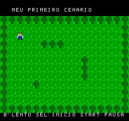
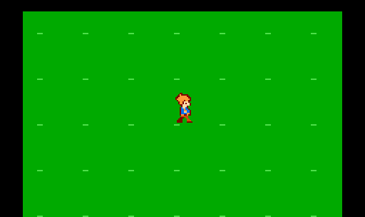
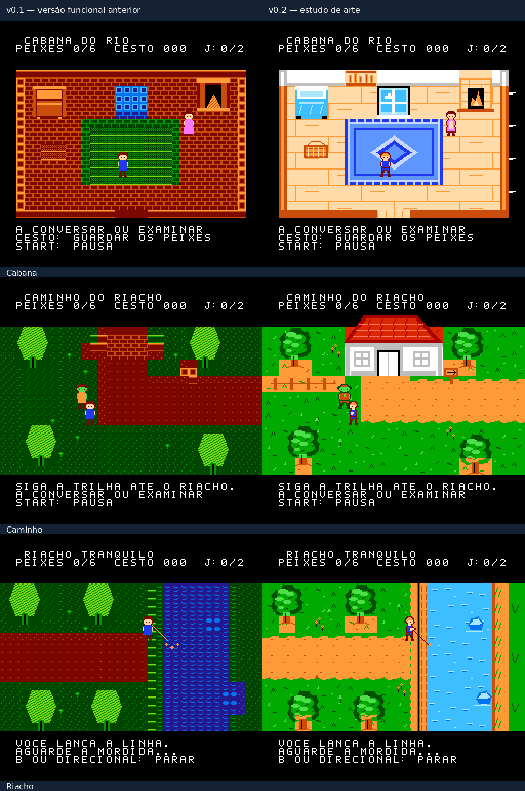
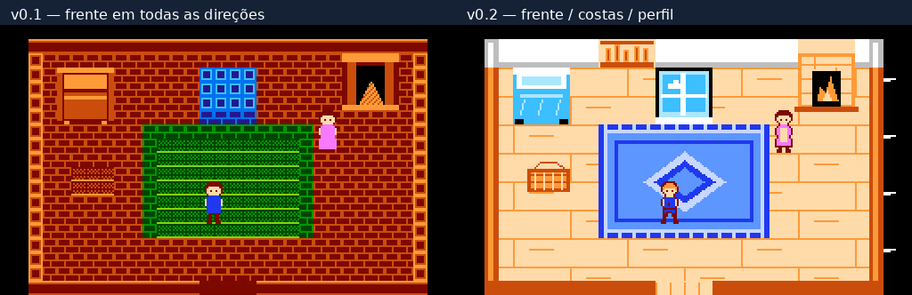
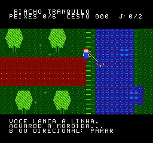
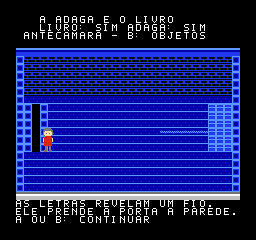
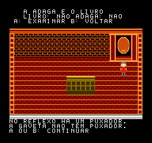
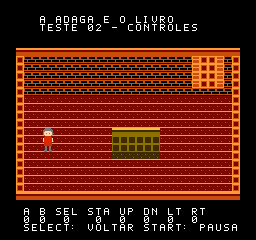

# A Adaga e o Livro

## Exercício Pixelorama — seus desenhos numa ROM

**[Baixar exercicio-pixelorama-jardim-v0.1.nes](downloads/exercicio-pixelorama-jardim-v0.1.nes)** — no GitHub, use **Download raw file**.
Personagem 16×16, piso e arbusto desenhados pelo usuário no Pixelorama.
Direcional move; Start pausa; Select reinicia a posição; B reduz a velocidade.
A animação é frontal em todas as direções. Os arbustos bloqueiam a passagem.



[Controles, fontes Pixelorama e validação](game/tutorial-garden/README.md).
Este é um exercício independente; não substitui os recursos do jogo principal.

## Laboratório atual — matrizes externas oficiais

**[Baixar laboratorio-caminhada-externa-v0.1.nes](downloads/laboratorio-caminhada-externa-v0.1.nes)** — no GitHub, use **Download raw file**.
Integra as 15 poses fornecidas pelo usuário, com as duas correções expressas
nas costas. Movimento nos quatro sentidos; A troca fundo, B câmera lenta,
Start pausa, Select centraliza. Sem áudio.

[Controles e validação](game/walk-lab/README.md) ·
[Matrizes e prancha exportada](art/characters/official-walk-v1/README.md).

A caminhada lateral criada aqui foi rejeitada pelo usuário. Os laboratórios
anteriores abaixo ficam como histórico técnico; a fonte atual de animação é
`art/characters/official-walk-v1/matrizes.json`.

## Laboratório — caminhada oficial v0.1

**[Baixar a ROM](downloads/laboratorio-caminhada-oficial-v0.1.nes)** — abra no GitHub e clique em **Download raw file**.
Novo teste para EverDrive / CRT: repouso oficial e caminhada lateral v2 aprovados,
seis sprites sem overlays. Esquerda/direita movem, A alterna o fundo,
B alterna câmera lenta, Start congela a pose e Select centraliza. Sem áudio.

[Controles e roteiro de avaliação](game/side-walk-lab/README.md) ·
[Resultado dos 30 testes no emulador](game/side-walk-lab/validation.txt).
As ROMs anteriores permanecem disponíveis para comparação.

## Personagem principal — especificação oficial

A referência oficial imutável está em
[`art/characters/main-official-v1/spec.py`](art/characters/main-official-v1/spec.py):
matrizes exatas de 16×24 pixels, seis sprites 8×8 sem overlays e três subpaletas.
[Prancha oficial](art/characters/main-official-v1/prancha-oficial.png) ·
[Composição e arquivos técnicos](art/characters/main-official-v1/README.md).
O laboratório acima integra o perfil oficial e a caminhada lateral aprovada.
As demais ROMs e os estudos abaixo são históricos anteriores à integração.

## Aventureiro — teste de caminhada v0.1

**[Baixar a ROM](downloads/aventureiro-caminhada-v0.1.nes)** — abra o arquivo e clique em **Download raw file**.
Laboratório independente com o personagem da última prancha de 16×24 pixels,
quatro sentidos e quatro fases de caminhada. Direcional move; A alterna fundo;
B alterna câmera lenta; Start pausa; Select centraliza. Sem áudio.



[Controles, critérios de avaliação e validação técnica](game/hero-lab/README.md).
As ROMs de pescaria continuam disponíveis abaixo para comparação.

## Estudo de arte — pescaria v0.2

**ROM para comparar:** [`downloads/primeira-pescaria-arte-v0.2.nes`](downloads/primeira-pescaria-arte-v0.2.nes).
Use **Download raw file** e abra no MesenCE em NTSC. Os controles e a sequência
da pesca são os mesmos da v0.1 aprovada.

- Interior claro, paredes brancas, piso de madeira clara, tapete azul e móveis
  redesenhados, retirando o vermelho dominante.
- Fachada com telhado e janelas, caminhos menos regulares, árvores com sombras,
  flores, margem arenosa e água azul-ciano.
- Herói com frente, costas e perfil, passadas alternadas, cores distintas para
  cabeça e roupa e pose de pesca. Mãe e orc também foram redesenhados.
- Mapper 0/NROM preservado, agora com CHR RAM e um conjunto de fundo por área.





As imagens vêm de frames reais do FCEUX. O GIF tem recorte e duração de quadros
ajustados para facilitar a inspeção; avalie a fluidez real na ROM.

Referências pesquisadas: **Crystalis, Willow, StarTropics, Kirby’s Adventure e
Little Samson**. As decisões e fontes estão em
[`game/river-art/ART_DIRECTION.md`](game/river-art/ART_DIRECTION.md).
Relatório técnico: [`game/river-art/VALIDACAO.md`](game/river-art/VALIDACAO.md).
Fonte/build: `game/river-art`; compilação `make -C game/river-art` com cc65 no PATH.

Esta é uma proposta de padrão visual para avaliação, ainda não uma direção
artística aprovada. A v0.1 permanece intacta para comparação.

## Primeira pescaria — v0.1 original

Uma nova abertura, séculos antes da mansão: um jovem ajuda a mãe e vai buscar
dois peixes para o jantar. Esta ROM começa o recorte de aventura de ação no
mundo antigo; os testes da mansão permanecem como histórico técnico.

**ROM:** [`downloads/primeira-pescaria-v0.1.nes`](downloads/primeira-pescaria-v0.1.nes).
Abra o arquivo no GitHub, clique em **Download raw file** e abra no MesenCE
com **File → Open**, preferencialmente em NTSC.



### Jogar

- Direcionais: caminhar e interromper a pesca.
- A: conversar, examinar e começar a pescar junto ao brilho na água.
- B: fechar uma leitura ou recolher a linha.
- Start: pausa a exploração, a pesca e a mudança de pontos; a música continua.
- Select: sem ação nesta versão.

No teclado configurado pelo usuário: **WASD** movem, **K = A**, **J = B** e
**I = Start**. O teclado é configurado no emulador, não na ROM.

Feche o pedido da mãe com A ou B e saia pela porta inferior da cabana. Siga
a trilha à direita até o riacho. Aproxime-se do brilho na margem e aperte A
uma vez: as capturas continuam automaticamente. O ponto muda de lugar com
o tempo. Se ele desaparecer, encontre o novo brilho e lance a linha novamente.

A bolsa comporta **seis peixes**. Volte pelo caminho, entre na cabana pela
entrada ao norte e fale com a mãe. Ela recebe **dois peixes uma única vez**;
os demais ficam com você. O cesto à esquerda guarda os excedentes e libera
a bolsa. Depois do jantar é possível continuar pescando e armazenando.

O HUD mostra `PEIXES`, `CESTO` e `J:0/2` (peixes entregues para o jantar).
Após a entrega, ele passa para `J:2/2`. O cesto guarda até 999 peixes;
se atingir o limite, o excesso permanece na bolsa.

Há três telas conectadas: cabana, caminho e riacho, um pescador orc com falas
curtas, água animada, caminhada e pose de pesca. Inclui uma primeira trilha
original curta e efeitos de lançamento, captura e interação, nos canais
padrão do NES. Toda atividade ocorre no mapa, sem cenas dedicadas.

**Reset começa uma nova partida. Não há salvamento permanente**, combate,
classes, XP, lojas, outras profissões ou ciclo de dia/noite. Arte e música são
a primeira proposta audiovisual deste recorte e ainda serão refinadas.

### Código e validação

Fonte: [`game/first-river`](game/first-river).
Compilação: `make -C game/first-river`, com ca65/ld65 do cc65 no PATH.
Relatório: [`game/first-river/VALIDACAO.md`](game/first-river/VALIDACAO.md).
Checksums: [`downloads/SHA256SUMS.txt`](downloads/SHA256SUMS.txt).

Formato NROM-256, mapper 0, 32 KiB PRG + 8 KiB CHR, 40.976 bytes.
Validada no FCEUX; o novo recorte ainda precisa do teste do usuário no
MesenCE e de validação em NES/EverDrive e Phantom System.

## Histórico de protótipos anteriores

As versões abaixo pertencem à investigação técnica anterior e continuam
disponíveis. Não representam a história ou a direção atual do novo jogo.

## Novo: segunda sala e primeiro uso dos objetos

ROM: [`downloads/vinculo-v0.1.nes`](downloads/vinculo-v0.1.nes).
Use **Download raw file** e abra no MesenCE em NTSC.



1. Resolva o puzzle do espelho e recolha livro e adaga, como na ROM anterior.
2. Examine novamente o armário: **A confirma entrar na passagem; B cancela**.
3. Na antecâmara, **B abre os objetos**. Cima/Baixo escolhem livro ou adaga;
   A usa o objeto e B volta. O livro revela o vínculo; a adaga precisa de alcance.
4. A porta da esquerda permite voltar ao quarto, usando A próximo dela.
5. Depois de liberar a porta da direita, aproxime-se e examine-a para concluir
   este teste. Não há terceira sala nesta versão.

No teclado configurado pelo usuário: **K = A**, **J = B**, **W/S = Cima/Baixo**.
Start pausa; Select reposiciona na sala atual, preservando todos os estados.
Reset reinicia o teste inteiro. Não há salvamento permanente.

O vínculo e a porta mudam de aparência conforme o uso dos objetos. Revelar,
cortar e concluir são estados distintos. As descobertas, o inventário e o
vínculo persistem ao ir e voltar entre as salas. Não há combate ou áudio ainda.

Código e relatório: [`rom-tests/link`](rom-tests/link). As ROMs anteriores
continuam disponíveis e não foram alteradas.

## Novo: interação e puzzle do espelho

ROM: [`downloads/espelho-v0.1.nes`](downloads/espelho-v0.1.nes).
Abra o arquivo e use **Download raw file**, depois **File → Open** no MesenCE.



- Direcionais: movimentar a personagem; perto do armário, A abre a inspeção.
- No menu do armário: Cima/Baixo escolhem o objeto, A examina e B cancela.
- Durante uma leitura: A ou B fecham o texto. Segurar A não avança várias etapas.
- Start: pausa/despausa. Select: reposiciona sem apagar o progresso do puzzle.
- No seu mapeamento: **K = A/examinar**, **J = B/voltar**, W/S navegam no menu.
- A e B agora são interação/voltar; não mudam mais a cor da roupa nesta ROM.

Explore o espelho, a gaveta e a porta. As respostas dependem das descobertas.
Abrir o compartimento mostra os objetos; recolhê-los exige uma nova interação.
O topo da tela registra os objetos coletados. Select preserva o progresso;
**Reset do emulador começa uma nova tentativa**, sem inventário ou descobertas.

Esta versão termina na coleta do livro e da adaga. Não há uso de poderes,
passagem para outra sala, combate, áudio ou salvamento permanente ainda.
A fonte atual usa texto em português sem acentos. A arte continua provisória.

Código e verificação: [`rom-tests/mirror`](rom-tests/mirror).
Compilação: `make -C rom-tests/mirror`, com ca65/ld65 no PATH.

## Novo: sala com personagem e controles

ROM: [`downloads/sala-controles-v0.1.nes`](downloads/sala-controles-v0.1.nes).
Abra o arquivo no GitHub e clique em **Download raw file** para baixar.
No MesenCE, use **File → Open** e selecione o `.nes`.



| Controle | Resposta esperada |
| --- | --- |
| Direcionais | Movem o personagem nas quatro direções. Paredes e mesa bloqueiam o movimento. |
| A, segurado | Muda a cor do casaco para violeta. |
| B, segurado | Muda a cor do casaco para dourado. A tem prioridade se ambos estiverem pressionados. |
| Select | Reposiciona o personagem no ponto inicial, inclusive durante a pausa. |
| Start | Alterna pausa. Segurar não alterna repetidamente. Um P aparece no topo. |

As legendas **A B SEL STA UP DN LT RT** mostram `1` quando cada botão está
pressionado e `0` quando está solto. Durante a pausa, o movimento para, mas
os indicadores e as mudanças de cor continuam funcionando.

Esta sala é um ensaio de movimentação livre nas quatro direções; não fecha
a perspectiva do jogo definitivo. Não há áudio, combate, puzzles, troca de
salas ou salvamento. Os gráficos foram desenhados para este teste, com tiles
e sprites nativos do NES; não são a arte final do jogo.

- Mapper 0, 16 KiB PRG + 8 KiB CHR, 24.592 bytes, alvo NTSC.
- 43 verificações automatizadas passaram no FCEUX 2.6.5.
- Código e validação: [`rom-tests/movement`](rom-tests/movement).
- Ainda não validada no MesenCE do usuário, NES físico ou Phantom System.

Compilar no ambiente preparado:

```sh
export PATH=/workspace/nes-tools/cc65/bin:$PATH
make -C rom-tests/movement
```

## Anterior: tela azul

Este repositório contém um teste técnico nativo de NES. Ainda não é o piloto
do jogo e não contém os cenários, personagens ou mecânicas planejados.

## Baixar e executar no Windows

1. Abra a pasta [`downloads`](downloads) nesta branch.
2. Abra **tela-azul-v0.1.nes** e clique em **Download raw file** (seta para baixo).
3. No seu emulador de NES para Windows, use **File → Open / Arquivo → Abrir**
   e selecione o arquivo `.nes` baixado.
4. O resultado esperado é **uma tela inteira azul sólida**, sem texto, animação,
   som ou resposta aos botões. Após alguns quadros de inicialização, a cor fica
   estável. A tonalidade pode variar entre paletas, emuladores e televisores.
5. Reinicie a ROM pelo comando Reset: a tela deve voltar a ficar azul.

Se conseguir abrir, informe o nome/versão do emulador e se a tela ficou azul.
Este teste confirma o caminho compilação → GitHub → Windows → emulação.
Não valida ainda gameplay, leitura de controles, áudio ou hardware real.

## Formato

- Arquivo `.nes` com cabeçalho iNES 1.0.
- Mapper 0 (NROM-128), 16 KiB de PRG ROM e 8 KiB de CHR ROM.
- Tamanho total: **24.592 bytes**.
- Sem BIOS, dependências externas, salvamento ou dados de jogos comerciais.
- O programa mantém a renderização desligada e configura a cor universal de
  fundo da PPU como `$01`. Isso é saída nativa de vídeo do NES.
- Alvo inicial: NES NTSC. Não utiliza efeitos com temporização fina de PPU.

## Compilar

Requer `ca65`, `ld65` (cc65) e Make. No ambiente preparado:

```sh
export PATH=/workspace/nes-tools/cc65/bin:$PATH
make -C rom-tests/solid-color
```

O código está em [`rom-tests/solid-color`](rom-tests/solid-color).
O checksum do binário está em [`downloads/SHA256SUMS.txt`](downloads/SHA256SUMS.txt).

No PowerShell do Windows, para conferir o checksum:

```powershell
Get-FileHash .\tela-azul-v0.1.nes -Algorithm SHA256
```

## Validação

O resultado do teste em FCEUX e a inspeção do binário serão registrados em
[`rom-tests/solid-color/VALIDACAO.md`](rom-tests/solid-color/VALIDACAO.md).
