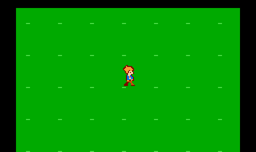

# Aventureiro — laboratório de caminhada v0.1

ROM independente para avaliar o personagem da última prancha em movimento.
As poses paradas de 16×24 pixels são exatamente as de
`art/characters/adventurer-static-v1`. O perfil esquerdo usa espelhamento.

## Baixar e testar

Abra [a ROM](../../downloads/aventureiro-caminhada-v0.1.nes) no GitHub e clique
em **Download raw file**. Carregue no MesenCE em NTSC. Comece em escala 1×,
sem filtros, para avaliar o tamanho; amplie depois para inspecionar os pixels.

| Controle NES | Tecla configurada pelo usuário | Ação |
| --- | --- | --- |
| Direcional | W A S D | Mover |
| A | K | Alternar fundo claro/verde |
| B | J | Alternar câmera lenta, indicador L |
| Start | I | Pausar, indicador P |
| Select | U | Centralizar |

A câmera lenta reduz movimento e animação juntos pela metade. Soltar o
direcional retorna à pose parada do último sentido. Select funciona durante
a pausa. As bordas limitam o movimento. Esta ROM é silenciosa.

Recorte de frames reais do FCEUX, ampliado 2× sem suavização e desacelerado
para inspeção. Avalie a fluidez e a cadência na ROM.

## O que avaliar

- Silhueta e leitura no tamanho normal de jogo.
- Passada lateral: alternância e cruzamento das pernas.
- Frente e costas; transições ao virar e ao parar.
- Contraste da roupa e do cabelo nos dois fundos.

Esta é uma proposta de animação para aprovação. A pescaria permanece intacta.

## Implementação e verificação

- NROM-128: 16 KiB PRG + 8 KiB CHR ROM, arquivo iNES de 24.592 bytes.
- Oito sprites 8×8: seis de base e dois sobrepostos para a pele.
- Máximo de quatro sprites por linha; três paletas de sprite.
- Cada sprite usa transparência e até três cores.
- Três conjuntos de direção com pose parada + quatro fases de caminhada.
- Um pixel por quadro por eixo em velocidade normal; diagonais permitidas.
- CHR parado comparado byte a byte com os três arquivos estáticos.
- **25 verificações passaram no FCEUX 2.6.5**: direções, fases de caminhada,
  pausa, controles, câmera lenta, espelhamento, limites, reset e OAM.
- Última escrita PPU medida até 1.626 ciclos após entrada na NMI,
  dentro do VBlank NTSC.
- Hardware real e Mesen do usuário: aguardando validação.

Compilar com cc65 no PATH: `make -C game/hero-lab`.
`assets.py` gera os dados NES a partir dos pixels estáticos.
`check.lua` e `run_check.py` verificam a execução no emulador instalado
neste ambiente. `motion.lua` captura frames por entrada de controle,
sem editar RAM.
