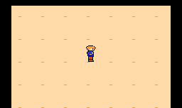
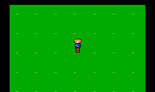

# Laboratório de caminhada oficial — v0.1

[Baixar a ROM](../../downloads/laboratorio-caminhada-oficial-v0.1.nes).
Abra o arquivo no GitHub e use **Download raw file**. Copie o `.nes` para o
cartão do EverDrive e abra pelo menu do cartucho, como nos testes anteriores.

Laboratório lateral independente, silencioso. Integra exatamente o repouso
oficial e as quatro fases da caminhada lateral v2 aprovadas, com pernas mais
grossas. Não altera a pescaria, as ROMs anteriores ou as matrizes oficiais.

| Controle NES | Tecla configurada no Mesen do usuário | Ação |
| --- | --- | --- |
| Esquerda / direita | A / D | Caminhar |
| A | K | Alternar fundo claro / verde |
| B | J | Alternar câmera lenta; indicador L |
| Start | I | Pausar posição e quadro atual; indicador P |
| Select | U | Centralizar e restaurar o repouso direito |

Cima e baixo não movem o personagem. Select também funciona durante a
pausa. A troca de fundo e de velocidade funciona com o teste despausado.
O perfil esquerdo é espelhado, inclusive a faixa da roupa.

## Avaliar no Phantom System / CRT

- Aparência e espessura das pernas em movimento.
- Cadência, velocidade de avanço e sensação de pés deslizando.
- Viradas e retorno ao repouso quando o direcional é solto.
- Contraste sobre os dois fundos.
- Câmera lenta e pausa para observar cada pose.

Velocidade normal: um pixel por quadro NTSC; cada pose dura oito quadros.
Ciclo completo: 32 quadros, aproximadamente 0,53 s. A câmera lenta reduz
deslocamento e animação pela metade. A cabeça não oscila verticalmente.
Não há seleção de velocidade adicional, áudio, combate ou exploração vertical.

## Implementação

NROM-128 / mapper 0: 16 KiB PRG, 8 KiB CHR ROM, iNES de 24.592 bytes.
Sprite table em $1000; seis sprites 8×8 por pose e dois por scanline,
sem overlays. Demais entradas OAM ocultas. Subpaletas oficiais:

- Cabeça: transparente, $0F, $27, $37.
- Tronco: transparente, $0F, $12, $37.
- Pernas: transparente, $0F, $17, $0F não usado.

Os CHRs de `art/characters/main-walk-side-v2` são copiados diretamente para
a ROM, sem conversão artística. Os RGBs no emulador ou na CRT dependem do
sinal e da paleta usada; o programa preserva os índices NES oficiais.

`make -C game/side-walk-lab` com cc65 no PATH gera a ROM.
`check.lua` e `run_check.py` verificam sua execução no FCEUX instalado no
ambiente. Consulte `validation.txt` para os resultados. Esta versão ainda
aguarda o teste do usuário no Mesen e no EverDrive / CRT.

Passaram 30 verificações no FCEUX 2.6.5: cinco conjuntos CHR idênticos aos
aprovados, paletas, OAM, controles, repouso, espelhamento, pausa, câmera lenta,
cadência de oito quadros, limites e reset. Última escrita PPU medida em até
1.457 ciclos após entrada na NMI, dentro do VBlank NTSC. A recompilação
integral também produziu o mesmo SHA-256 da ROM testada.

Imagens do FCEUX, recortadas para a área do personagem e sem ampliação.
