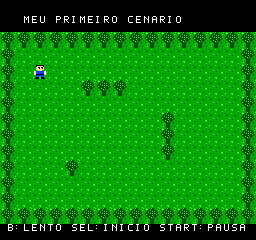

# Meu primeiro cenário — exercício Pixelorama v0.1

[Baixar a ROM](../../downloads/exercicio-pixelorama-jardim-v0.1.nes).
Abra no GitHub, clique em **Download raw file**, carregue no Mesen ou copie
o `.nes` para o cartão do EverDrive e abra pelo menu do cartucho.

Este exercício separado foi montado com os três projetos desenhados pelo
usuário: personagem, piso e arbusto. Os arquivos `.pxo` originais estão em
`source/`. Não houve redesenho, redução de cores ou substituição pelo herói
oficial do jogo principal.

## Controles

| Controle NES | Tecla configurada no Mesen do usuário | Ação |
| --- | --- | --- |
| Direcional | W A S D | Mover |
| Start | I | Pausar posição e pose; indicador P |
| Select | U | Voltar à posição inicial |
| B | J | Câmera lenta; indicador L |

A não tem função. O teste não tem música ou efeitos sonoros.
Select funciona durante a pausa; B requer despausar.

O personagem usa a animação frontal desenhada pelo usuário em todas as
direções, sem espelhamento ou vistas inventadas. Ao parar, retorna ao quadro 1.
Os quatro quadros mantêm a sequência e a cadência do projeto: dez quadros
NTSC por pose, aproximadamente 6 FPS. A câmera lenta reduz movimento e
animação pela metade. Diagonais avançam um pixel por eixo; não há normalização.

## Cenário e colisão

O piso 16×16 é repetido para preencher o espaço. O arbusto 16×16 é uma peça
de background, repetida na borda e em pequenos grupos no campo. Não consome
sprites OAM. Cada arbusto bloqueia o quadrado inteiro de 16×16, incluindo
os cantos onde a grama aparece no desenho.

O personagem também tem uma caixa de colisão inteira de 16×16, incluindo
as margens transparentes. Em movimentos diagonais, cada eixo é testado
separadamente, permitindo deslizar junto ao obstáculo quando há passagem.
Não há dano, objetivo, inventário, rolagem de tela ou edição de mapa em jogo.

## Importação dos projetos

`assets.py` lê o ZIP interno do `.pxo`, seus pixels RGBA e os offsets de cada
cel. Reconstrói o canvas original de 16×16, sem reposicionar ou recortar os
quadros individualmente. Os PNGs em `imported/` mostram essa reconstrução.
O personagem enviado nesta entrega é usado, incluindo a alteração feita
depois do primeiro arquivo que analisamos.

O importador deste exercício aceita exatamente os arquivos atuais: camada
visível única, sem efeitos, opacidade integral, duração uniforme de quadros.
Ele não é um importador geral de todos os recursos do Pixelorama.

Cada pose ou peça ocupa quatro tiles 8×8, em ordem por linha, 64 bytes CHR.
Os tiles são exportados e decodificados novamente: os pixels RGBA resultantes
são idênticos aos extraídos do projeto. As cores são mapeadas aos índices NES:

- Personagem: transparente, $0F, $12, $37 — uma subpaleta de sprites.
- Cenário: fundo compartilhado $0F; verdes $0A, $1A, $2A — uma subpaleta de background.
- Texto: outra subpaleta de background, sobre área preta.

O hardware recebe índices; o RGB aparente pode variar com o emulador e a CRT.
Os pixels e o mapeamento das cores permanecem preservados.

## Programa e validação

Assembly 6502, ca65/ld65, mapper 0 / NROM-128: 16 KiB PRG e 8 KiB CHR ROM.
Arquivo iNES de 24.592 bytes. Quatro sprites 8×8 para o personagem, no máximo
dois por scanline, sem overlays. Restante da OAM oculto.

A NMI envia primeiro a OAM e os indicadores durante o VBlank. Depois calcula
controles, colisões e a OAM do próximo quadro, sem novas escritas à PPU.

Passaram **34 verificações no FCEUX 2.6.5**, incluindo CHR completo na PPU,
paletas, mapa, movimento, cadência, repouso, colisão pelos quatro lados,
deslizamento, bordas, pausa, reset e uso de sprites. O teste também confere
a cada quadro simulado que a caixa do personagem não se sobrepõe a arbustos.
Última escrita PPU medida: até **588 ciclos** após entrada na NMI.
Relatório: `validation.txt`. Teste no console desta versão aguarda o usuário.

Compilar com cc65 no PATH e Python/Pillow instalados:
`make -C game/tutorial-garden`.
`run_check.py` executa `check.lua` no FCEUX instalado neste ambiente.
