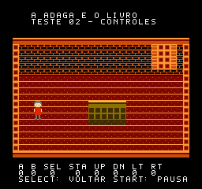

# Sala e controles — v0.1

## Implementação

ROM nativa NROM-128, iNES 1.0, 16 KiB PRG + 8 KiB CHR.
Sala de uma tela, personagem 16×24 formado por seis sprites 8×8, nametable
estática e indicadores atualizados durante VBlank. Arte e fonte bitmap
originais, geradas deterministicamente por `assets.py`.

O movimento é de um pixel por quadro e por eixo, com limites da sala e colisão
separada por eixo com a mesa. Direções opostas se cancelam. Na diagonal, ambos
os eixos avançam: a velocidade diagonal não é normalizada neste teste.

Botões são lidos serialmente em `$4016`, uma vez por NMI. Start e Select
usam detecção de nova pressão; A e B usam o estado mantido.

## Testes executados

FCEUX 2.6.5, NTSC, NewPPU, porta Qt GamePad.0, display virtual Xvfb.
**43 verificações passaram**, incluindo:

- Posição inicial e tiles OAM da personagem.
- Tile da mesa na nametable.
- Bit lido, indicador de tela e soltura de cada um dos oito botões.
- Pausar, despausar e segurar Start sem alternâncias repetidas.
- Bloqueio pela mesa e caminho livre ao redor dela.
- Limites superior, inferior, esquerdo e direito da sala.
- Cancelamento de direções opostas.
- Select reposicionando a personagem mesmo durante pausa.
- Paletas A, B, prioridade A+B e retorno à cor padrão.
- Reset restaurando posição e estado de pausa.
- Escritas em `$2007` até **1.626 ciclos CPU após entrada no NMI** no trecho
  medido, abaixo do limite conservador de 2.200 usado no teste NTSC.

A medição é da emulação e do percurso de código exercitado, não uma prova de
precisão de todos os efeitos de PPU ou de compatibilidade em hardware.
FCEUX tem a limitação conhecida de borda fina de VBlank registrada no ambiente;
esta ROM não utiliza efeitos de raster ou sincronização nessa borda.

Capturas reais, sem reconstrução por ferramenta generativa:



## Repetir no ambiente preparado

```sh
export PATH=/workspace/nes-tools/cc65/bin:$PATH
make -C /workspace/NES-BOOK-N-DAGGER/rom-tests/movement
mkdir -p /workspace/artifacts/rom-movement
NES_ROOM_OUTPUT=/workspace/artifacts/rom-movement \
  /workspace/nes-tools/emulator/bin/fceux-headless --no-config 1 \
  --loadlua /workspace/NES-BOOK-N-DAGGER/rom-tests/movement/check.lua \
  /workspace/NES-BOOK-N-DAGGER/downloads/sala-controles-v0.1.nes
```

O script escreve `validation.txt`, `room.gd`, `button-a.gd` e `reset.gd`.
Uma cópia do relatório desta execução está em `resultado-fceux.txt`.
Os hashes das duas ROMs estão em `downloads/SHA256SUMS.txt` na raiz.

## Limites

Ainda sem teste nesta execução no Windows/MesenCE, EverDrive, NES físico ou
Phantom System. Não há áudio, gameplay do piloto, inventário ou salvamento.
No NTSC a lógica avança uma vez por quadro; não foi adaptada para igualar a
velocidade em PAL/PAL-M. Para testar, abra o `.nes` como NTSC no seu emulador.
